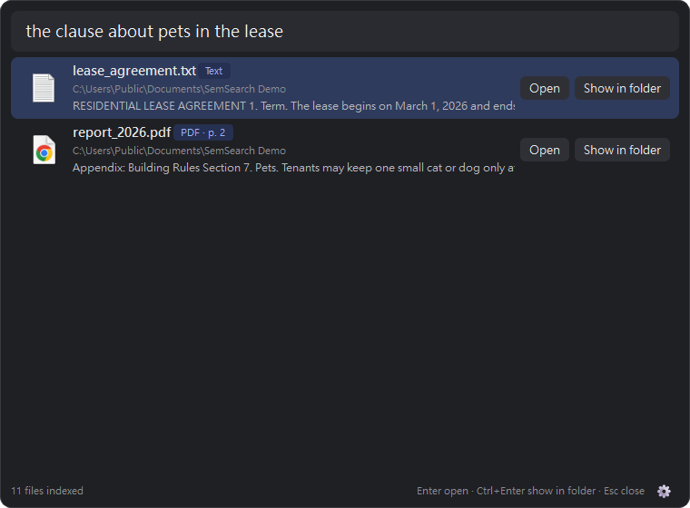
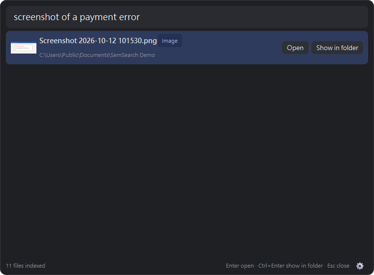
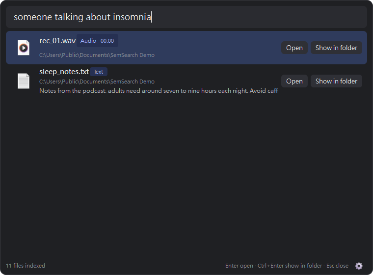

<h1 align="center">🔎 SemSearch</h1>

<p align="center">
  <b>A lightweight AI file finder for Windows.</b><br/>
  Describe a file in plain words and find it. SemSearch understands what's <i>inside</i> your photos, PDFs, recordings and videos.<br/>
  Runs 100% offline on your PC, powered by Google's EmbeddingGemma 2.
</p>

<p align="center">
  <a href="https://github.com/a303990366/semsearch/releases/latest"></a>
</p>

<p align="center">
  
  
  
  
  
</p>

<p align="center">
  
</p>

Windows Search only matches file names. SemSearch matches **meaning**: press `Ctrl+Alt+Space`, type what you remember, and jump straight to the file, the PDF page or the second of the video where it appears.

- "a dog on the beach" → finds the photo
- "the clause about pets in the lease" → finds page 2 of the PDF
- "screenshot of the payment failed error" → finds the screenshot; the model reads text inside images, no OCR needed
- "someone talking about insomnia in a video" → jumps to 00:30 in the video
- Works across languages: an English query finds Chinese documents, and the other way around

Under the hood it uses Google DeepMind's [EmbeddingGemma 2](https://huggingface.co/google/embeddinggemma-2) (740M parameters, Apache 2.0). The model puts text, images and audio into a single vector space, so one sentence can match a photo or a recording with a similar meaning.

## Features

- **Desktop assistant**: lives in the system tray. Press `Ctrl+Alt+Space` to open the search box; results update as you type
- **Open files directly**: Enter opens the file, Ctrl+Enter shows it in File Explorer. If VLC is installed, audio and video open at the matching timestamp
- **Multiple folders**: choose which folders to index, and exclude subfolders you don't want
- **Automatic updates**: files that are added, changed or deleted are re-indexed about 5 seconds later
- **Points to the right spot**: PDFs show the page number; audio and video show the timestamp
- **Scanned PDFs**: pages without extractable text are rendered and embedded as images
- **Hybrid ranking**: semantic similarity first, with a small boost for exact keyword matches
- **English & 繁體中文 UI**: switch any time in Settings
- **Progress and notifications**: shows the remaining time while indexing, and reports how many files succeeded, failed or were skipped when it finishes

Supported formats: txt / md / source code / html, PDF, docx, jpg / png / heic / webp…, mp3 / wav / m4a…, mp4 / mov / mkv…

<p align="center">
  
  
  <br/>
  <sub>Left: a screenshot found by the error it shows. Right: a voice recording found by what was said. The UI comes in English (default) and Traditional Chinese.</sub>
</p>

## Try it (Windows)

Download `SemSearch.zip` from Releases, unzip it, and double-click `SemSearch.exe`. On first launch it downloads the model (about 1.5 GB). Step-by-step guides: [English](packaging/README.txt) · [繁體中文](packaging/使用說明.txt).

The packaged build runs on the CPU, so it works on any Windows x64 machine, but each photo takes 2–5 seconds. For GPU acceleration, run from source as described below.

## Run from source

Requires Python 3.12. If you have an NVIDIA GPU, install the CUDA build of PyTorch.

```powershell
uv venv .venv --python 3.12
uv pip install --python .venv\Scripts\python.exe torch torchvision --index-url https://download.pytorch.org/whl/cu128
uv pip install --python .venv\Scripts\python.exe -r requirements.txt

# Desktop assistant
.venv\Scripts\pythonw.exe SemSearch.pyw

# Or use the command line
.venv\Scripts\python.exe -m semsearch index D:\Photos
.venv\Scripts\python.exe -m semsearch search "a dog on the beach"
```

Speed on an RTX 4060: 0.05 s per text chunk, 0.15 s per photo, 0.15 s per 30 s of audio, about 0.3 s per query.

## Architecture

```
semsearch/
  app.py       Desktop assistant: tray icon, global hotkey, search box, settings, file watcher, background indexing
  indexer.py   Scans folders and finds new, changed and deleted files (text first, video last)
  extract.py   Splits files into embeddable chunks and records page numbers or timestamps
               (decodes in memory with Pillow and PyAV)
  embedder.py  EmbeddingGemma 2; search queries take priority and background indexing yields to them
  store.py     SQLite: vectors stored as float16 BLOBs, plus an FTS5 full-text index
  search.py    Ranks by semantic similarity with a keyword-match boost, keeps the best chunk per file
  ocr.py       Built-in Windows OCR (not enabled; the model already reads text inside images)
```

Settings, the index and the log live in `~/.semsearch/`. The model is stored in the Hugging Face cache.

## Packaging

```powershell
packaging\build.ps1
```

This produces `packaging/dist/SemSearch/` (CPU build) and `SemSearch.zip`. Before the first build, create the packaging environment; the steps are at the top of `build.ps1`.

## Known limitations

- Windows only for now (the global hotkey, autostart and File Explorer integration use Windows APIs)
- PDFs show the page number but can't open directly at that page, because every PDF viewer takes different arguments
- With many near-identical screenshots, vectors alone may not tell them apart; OCR may come back for exact matching
- The test photos and videos are not included in `testdata/` (they come from Wikimedia Commons, whose licenses require attribution), so `scripts/smoke_test.py` needs a few photos of your own

## License

The code is released under the [MIT](LICENSE) license. The EmbeddingGemma 2 model is licensed under Apache 2.0; it is downloaded from Hugging Face on first run and is not part of this repository.
